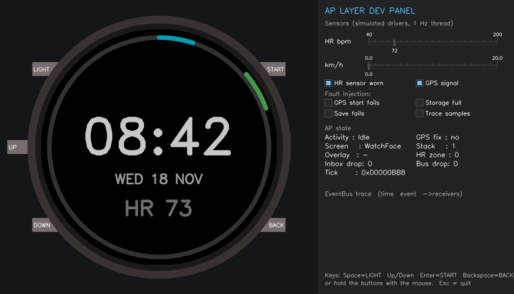
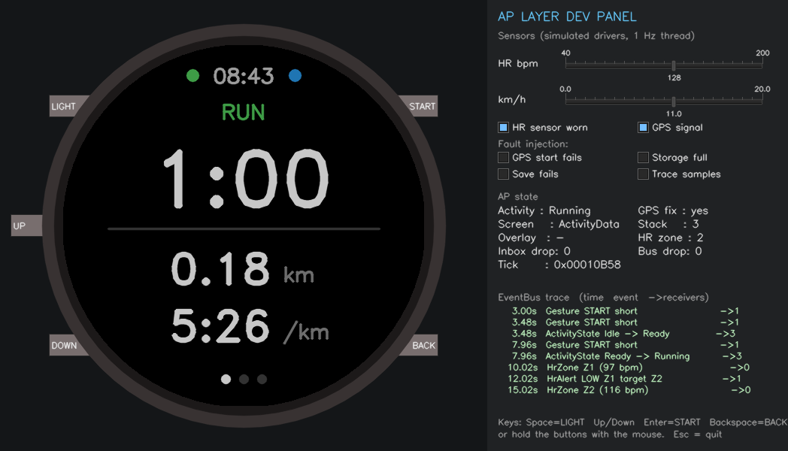
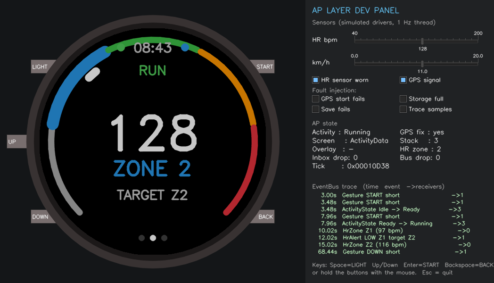
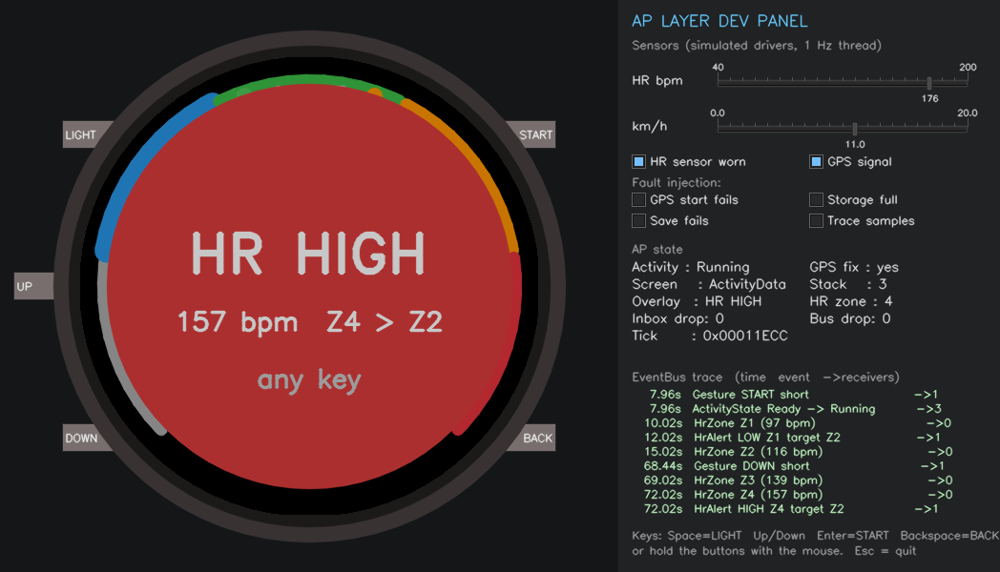
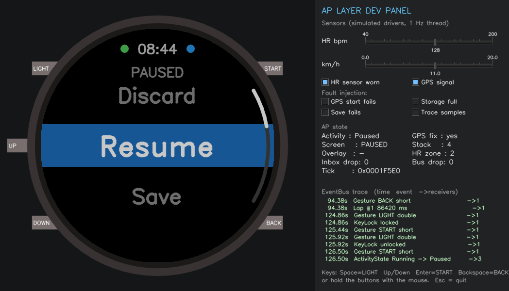

# Fitness Watch Simulator: Application Layer Architecture in C++

A Windows simulator of a GPS running watch, built to show **how the application (AP) layer is designed**: the part between drivers/services and the screen.

The backend (GPS, optical HR, storage) is simulated. The graphics are deliberately simple. What matters is the middle layer: how gestures, sensor data and screens are coordinated with object-oriented design, under embedded constraints.

| Watch face | Running | Heart-rate page | HR alert | Pause menu |
|---|---|---|---|---|
|  |  |  |  |  |

## What the AP layer does

```
 5 buttons ──► GestureRecognizer ──► InputRouter (Chain of Responsibility)
                                        KeyLock → Overlay → Navigator(top Screen) → Backlight
                                                               │ ICommand
 HR / GPS driver threads                                       ▼
   └─ postHr/postGps ─► WatchApp inbox ─► EventBus ◄── ActivitySession (State pattern)
        (mutex, bounded)   (Active Object)   │  ▲         IGpsService / IActivityRecorder
                                             │  └── HrZoneMonitor (hysteresis, debounce)
                                             ▼
                        ActivityFlowCoordinator (Mediator) ─► Navigator (screen stack)
                        OverlayManager (toasts, alerts, vibration)
                                             │
                         UiModel snapshot ─► Screen::render (NVI) ─► ICanvas ─► OpenCV
```

## Design patterns and where they are used

| Problem | Technique | Where |
|---|---|---|
| Backends must be replaceable; AP must run in unit tests | Dependency Inversion: AP-owned interfaces, constructor injection | [`services.h`](ap/include/ap/services/services.h), [`main.cpp`](app/main.cpp) |
| Raw key edges → short / long / double press | Per-key state machine, injected time | [`gesture_recognizer`](ap/src/input/gesture_recognizer.cpp) |
| The same key means different things on different screens | Chain of Responsibility + Command | [`input_router.h`](ap/include/ap/input/input_router.h), [`commands.h`](ap/include/ap/ui/commands.h) |
| Activity lifecycle Idle → Ready → Running ⇄ Paused → Saved | State pattern (state objects are members, no heap), entry/exit actions | [`activity_session`](ap/src/activity/activity_session.cpp) |
| Modules must not call each other directly | Publish/Subscribe event bus with deferred dispatch, RAII `Subscription` | [`event_bus`](ap/src/event/event_bus.cpp) |
| Every screen gets the same lifecycle and chrome | NVI / Template Method | [`screen.h`](ap/include/ap/ui/screen.h) |
| Which screen follows which activity state | Mediator (`ActivityFlowCoordinator`) | [`activity_flow.h`](ap/include/ap/ui/activity_flow.h) |
| Screens must not touch services | View-model snapshot (MVP-lite) | [`ui_model.h`](ap/include/ap/ui/ui_model.h) |
| Sensor data arrives from other threads | Active Object: thread-safe inbox, single AP thread | [`watch_app`](ap/src/app/watch_app.cpp) |
| Timeouts without blocking | Soft timers with generation-checked handles | [`soft_timer`](ap/src/core/soft_timer.cpp) |
| Rendering library must be swappable | Adapter (`ICanvas` → OpenCV) | [`opencv_canvas`](platform/sim/opencv_canvas.cpp) |

## Embedded constraints, enforced by the build

The `ap` library is compiled with `/GR- /EHs-c- /D_HAS_EXCEPTIONS=0 /W4 /WX`:

- **No RTTI, no exceptions.** Errors are return values and events (`StartFailed`, `SaveFailed`).
- **No heap after `init()`.** Every container is fixed-capacity, with overflow counters. A test replaces `operator new` and runs a 2-minute activity with alerts, laps and save: [**0 allocations**](tests/watch_app_test.cpp).
- **No OS dependency.** Locking goes through `osal::IMutex`, and time is injected. Every `uint32_t` tick comparison is wrap-safe, and `--wrap` starts the simulator 30 s before the 49-day overflow.
- **No `std::function`, `std::string` or `std::vector`** in the AP layer. Events are a fixed-size tagged union (24 bytes).

The simulator itself (`platform/sim`, `app/`) is ordinary desktop C++: threads, heap, OpenCV. It stands in for drivers and the RTOS.

## Repository layout

```
ap/                 portable application layer (the interesting part)
  core/             RingBuffer, SoftTimerPool, wrap-safe time
  event/            Event (tagged union), EventBus, Subscription
  input/            GestureRecognizer, InputRouter, ICommand
  activity/         ActivitySession (State), ActivityMetrics
  health/           HrZoneMonitor
  ui/               Screen (NVI), Navigator, screens, overlay, coordinator
  app/              WatchApp (Active Object), settings
  services/         interfaces the AP layer needs (GPS, HR, recorder, ...)
platform/sim/       simulator: OpenCV canvas, sensor thread, CSV recorder, dev panel
app/main.cpp        composition root
tests/              GoogleTest suite (78 tests), fakes for every service
third_party/        OpenCV 4.10 (release DLL), cvui 2.9, GoogleTest 1.15 (vendored)
docs/               architecture, design decisions, demo script
```

## Build and run

Requirements: Windows x64, Visual Studio 2019 or newer (MSVC), CMake ≥ 3.20. All dependencies are vendored.

```bash
cmake -S . -B build
cmake --build build --config RelWithDebInfo
ctest --test-dir build -C RelWithDebInfo          # 78 tests
build\RelWithDebInfo\watch_sim.exe                 # interactive
build\RelWithDebInfo\watch_sim.exe --trace         # + event trace on the console
build\RelWithDebInfo\watch_sim.exe --script docs/demo.keys --out shots   # headless, writes PNGs
```

> Use `RelWithDebInfo` or `Release` for `watch_sim`. Only the release `opencv_world` DLL is vendored, because the debug one is larger than GitHub's 100 MB limit. `ap` and `ap_tests` build in any configuration.

**Controls:** Space = LIGHT · ↑/↓ = UP/DOWN · Enter = START · Backspace = BACK · Esc = quit. You can also hold the on-screen buttons with the mouse. Double-press LIGHT to toggle the key lock.

The dev panel on the right lets you move the HR and speed sliders, take away the GPS signal or HR contact, inject faults (GPS start, storage full, save failure), and watch every `EventBus` dispatch live.

## Further reading

- [docs/architecture.md](docs/architecture.md): class diagram, sequence diagrams, state machine
- [docs/design-decisions.md](docs/design-decisions.md): why each choice was made, and its trade-offs
- [docs/demo-script.md](docs/demo-script.md): a 5-minute live demo
