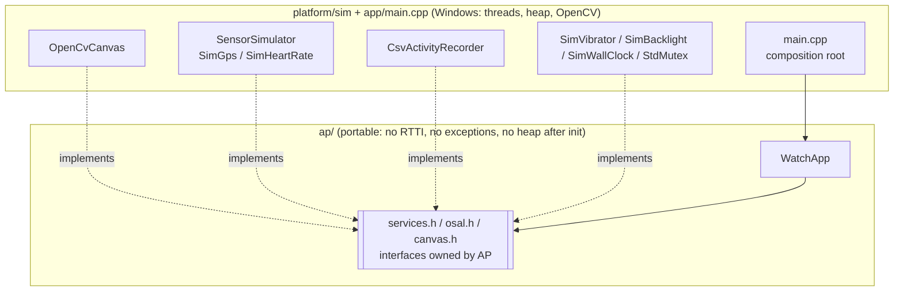
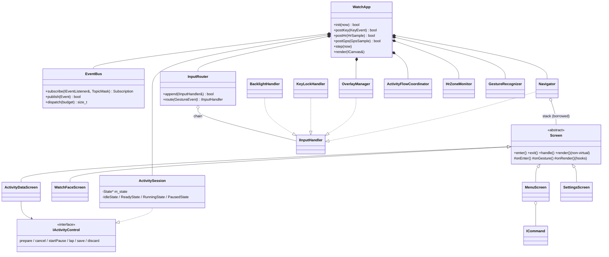
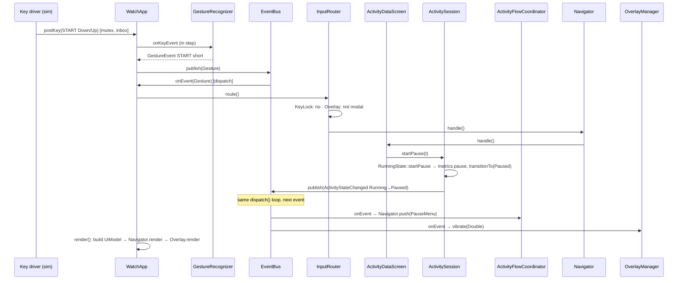

# Architecture

## 1. Layers and dependency direction



The arrows only point *into* `ap/`. The AP layer declares the interfaces it needs, and the platform implements them (Dependency Inversion). Porting to the watch means rewriting `platform/` and `main.cpp`, not `ap/`.

## 2. Main classes



Ownership is plain composition: every AP object is a member of `WatchApp` (`*--`). Screens and handlers are *borrowed* by the navigator and the router (`o--`), so popping a screen never destroys anything.

## 3. Sequence: pressing START while running



Two properties make this predictable:

* **Deferred dispatch.** `publish()` only enqueues. The session finishes its transition before anyone hears about it, and no listener is ever re-entered.
* **Single AP thread.** Only `postKey/postHr/postGps` are called from other threads, and they only touch the mutex-protected inbox.

## 4. Activity state machine

```mermaid
stateDiagram-v2
    [*] --> Idle
    Idle --> Ready: prepare / GPS.start()
    Idle --> Idle: prepare fails (StartFailed)
    Ready --> Idle: cancel
    Ready --> Running: startPause / recorder.begin(), metrics.start
    Ready --> Ready: recorder.begin fails (StartFailed)
    Running --> Running: lap / recorder.recordLap
    Running --> Paused: startPause / metrics.pause
    Paused --> Running: startPause / metrics.resume
    Paused --> Idle: save / close last lap, recorder.finish (Saved)
    Paused --> Paused: save fails (SaveFailed)
    Paused --> Idle: discard
    note right of Idle: entry: GPS.stop()  (single place, whatever path led here)
```

## 5. Threads and data flow

| Context | Calls | Touches |
|---|---|---|
| Sensor thread (sim) / ISR (watch) | `postHr`, `postGps` | inbox (mutex) only |
| UI thread in the simulator | `postKey`, `step`, `render` | everything in `ap/` |
| AP inside `step()` | drain inbox → recognizer/bus → timers → 1 s tick → `dispatch()` | single-threaded, run-to-completion |

The inbox is drained in bounded batches: at most 16 messages are copied out under the lock and processed without it, so a slow AP step never blocks a producer. When it is full, messages are counted as dropped and never block the producer, which is the right default for an ISR.

## 6. Input chain

| # | Handler | Consumes | Why here |
|---|---|---|---|
| 1 | `KeyLockHandler` | double LIGHT; everything while locked | must win over every screen |
| 2 | `OverlayManager` | any key while a *modal* alert is up | the alert must be acknowledged before the screen reacts |
| 3 | `Navigator` → top `Screen` | whatever the screen handles; otherwise BACK short pops | screen-specific meaning |
| 4 | `BacklightHandler` | LIGHT short | global fallback |

Adding a feature that intercepts keys (for example "touch lock" or a "workout step prompt") means adding one handler in the right place. No screen changes.
